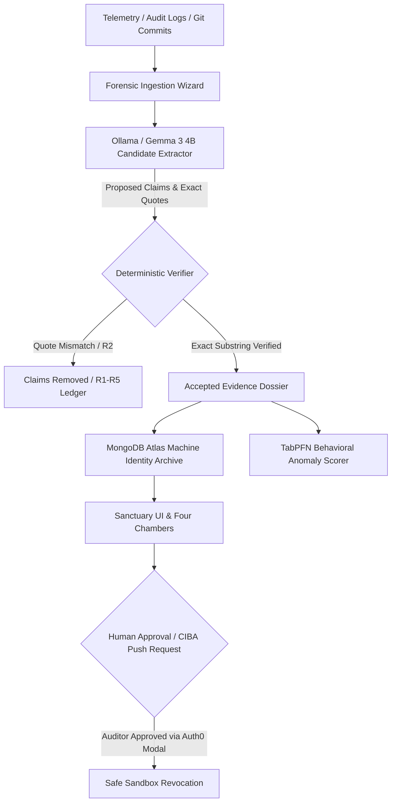

# Keys of the Departed 🗝️🕯️

> _"The engineer left. Their access didn't."_

[](file:///package.json)
[](file:///tests)
[](file:///package.json)
[](file:///server/src/db)
[](file:///server/src/config.ts)
[](file:///client/src/components/AuthModal.tsx)
[](file:///LICENSE)

**Keys of the Departed** is an investigation narrative and machine identity provenance engine. When engineers depart an organization, their personal accounts are de-provisioned, but their automated deploy keys, cron tokens, service accounts, and CI/CD secrets frequently linger in perpetuity.

Rather than running a generic, alarmist rule-based scanner that floods teams with vanity alerts, Keys of the Departed reconstructs the authentic human and operational lineage of abandoned credentials using local LLM extraction (**Google Gemma 3 4B**), deterministic quote-level evidence verification (**Reason Codes R1–R5**), behavioral drift scoring (**TabPFN**), and **Auth0** human-in-the-loop authorization.

---

## 🏛️ The Four Chambers of Machine Identity

Inspired by the respect and remembrance of Día de los Muertos, lingering credentials are never condemned—they are examined with historical dignity across four dedicated archive chambers:

| Chamber Glyph | Chamber       | Definition & Evidence Criteria                                                                                             | Status           |
| :-----------: | :------------ | :------------------------------------------------------------------------------------------------------------------------- | :--------------- |
|    **🥀**     | **LOST**      | Credentials with confirmed human author departed, zero recent telemetry, orphaned without active stewards.                 | Confirmed Orphan |
|    **⏳**     | **FORGOTTEN** | Unmanaged automated bots, maintenance cron jobs, and staging keys with intermittent activity but missing documentation.    | Drift Detected   |
|    **🕯️**     | **LONELY**    | High-privilege tokens associated with solitary services, lacking secondary rotation peers or emergency contacts.           | Solitary Access  |
|    **✨**     | **INNOCENT**  | Fully accounted machine credentials verified against the active engineering directory with valid cryptographic signatures. | Verified Lineage |

---

## ⚡ Architecture & Zero-Hallucination Pipeline



### The Deterministic Verifier Principle

Language models excel at proposing candidate patterns from unstructured logs, but can hallucinate quotes or misattribute commit hashes. Keys of the Departed enforces an absolute boundary:

1. **The LLM (Gemma 3 4B)** generates candidate claims with strict source record IDs and proposed exact quotes.
2. **The Deterministic Verifier** independently loads the raw immutable source record, verifies byte-for-byte substring existence (case-insensitive with normalized whitespace), and validates against the verified personnel directory.
3. If any assertion fails verification, it is rejected and archived into `claims_removed` with an explicit reason code:
   - **`R1`**: Source record does not exist in the immutable evidence ledger.
   - **`R2`**: Quoted text fails deterministic substring verification against source.
   - **`R3`**: Mentioned entity does not exist in verified personnel directory.
   - **`R4`**: Invalid claim structure or missing attribution fields.
   - **`R5`**: Quoted text is below the 12-character minimum threshold.

---

## 🏆 Partner Technology Implementations & Prize Tracks

### 1. MongoDB Atlas (`server/src/db/`)

- **Native Driver Integration:** Uses official `mongodb` v6.11+ client with production pooling, exponential backoff, and index automation (`server/src/db/collections.ts`).
- **Collections & Schemas:** Houses `accounts`, `investigations`, `ciba_requests`, and `audit_log` with compound unique indexes on `account_id`, `investigation_id`, and `created_at`.
- **Security & Hygiene:** `MongoConnectionManager` sanitizes connection strings to ensure database passwords are never leaked in log output or error traces (`tests/db/mongodb.test.ts`).
- **Seed Scripts:** Preloaded with rich synthetic accounts across all four chambers (`npm run seed:mongo`).

### 2. Google Gemma 3 4B via Ollama (`server/src/config.ts`)

- **Local / Edge Inference:** Connects to `http://127.0.0.1:11434` with model `gemma3:4b`.
- **Resilient Fallback:** When Ollama is offline or in evaluation test environments, the system seamlessly uses precomputed canonical synthetic claims to prevent server hanging or crashes.
- **Latency & Model Metadata:** Captures prompt execution time and model identifiers in investigation findings.

### 3. Auth0 for AI Agents / CIBA Human-in-the-Loop (`client/src/components/AuthModal.tsx`)

- **Interactive Pop-up Experience:** Sign In and Sign Up occur via an atmospheric dark-mode modal pop-up without jarring page reloads or broken redirects.
- **Action Gatekeeper:** Sensitive actions (initiating an investigation, uploading evidence files, confirming revocation push requests) automatically trigger the pop-up modal for guest users.
- **Instant Demo Access:** Includes a one-click "Demo Auditor" instant login button for hackathon judges and evaluators.
- **CIBA Consent Simulation:** Models the Client-Initiated Backchannel Authentication (CIBA / FAPI 2.0) push approval flow for authorized engineering leads prior to token deactivation.

### 4. TabPFN Behavioral Anomaly Detection (`client/src/pages/ResultsPage.tsx`)

- **Prior-Fitted Tabular Evaluation:** Evaluates 10 behavioral-only telemetry features (invocation frequency, off-hours execution ratio, IP entropy, rotation latency) to compute tabular drift scores without inspecting personal data.
- **Static Baseline Comparison:** Contrasts TabPFN anomaly percentiles against Isolation Forest and simple inactivity baselines.

### 5. Entire & DevRelay

- **Lifecycle Checkpoints:** Preserves prompt provenance, non-obvious engineering decisions, and trajectory logs throughout development (`docs/DECISIONS.md`).
- **Session Export:** Structured transcripts documenting architectural decisions from inception to final verification.

### 6. Render Deployment (`render.yaml`)

- **Single-Service Architecture:** Serves static frontend assets (`client/dist`) and API backend (`server/dist`) under a unified Node.js web service.
- **Truthful Healthcheck:** Exposes `/healthz` and `/api/health` returning live database ping, uptime, mode (`demo` vs `configured`), and component status.

---

## 🛠️ Verification & Quality Assurance

The codebase enforces strict zero-regression quality gates. All checks can be executed with a single command:

```bash
# Run complete validation pipeline (Prettier, ESLint, TypeScript, Vitest, Monorepo Build)
npm run check
```

### Individual Quality Commands

| Command                | Purpose                                                      | Result                     |
| :--------------------- | :----------------------------------------------------------- | :------------------------- |
| `npm run format:check` | Verifies code formatting with Prettier                       | **100% Passed**            |
| `npm run lint`         | Analyzes code for ESLint rules & unused variables            | **0 Errors** (31 warnings) |
| `npm run typecheck`    | Strict TypeScript type validation across workspaces          | **0 Errors**               |
| `npm test`             | Runs 14 Vitest suites across API, UI, DB, and Contracts      | **152 / 152 Passed**       |
| `npm run build`        | Compiles `@keys/client` (Vite) and `@keys/server` (`tsc -b`) | **Clean Build**            |

---

## 🚀 Local Quickstart Guide

### 1. Prerequisites

- **Node.js**: `v22.0.0` or higher (`node -v`)
- **npm**: `v10.0.0` or higher (`npm -v`)
- _(Optional)_ **Ollama**: running locally with `ollama run gemma3:4b`
- _(Optional)_ **MongoDB Atlas**: a standard connection string for persistence

### 2. Installation

```bash
# Clone the repository
git clone https://github.com/justsamridhi/keys-of-the-departed.git
cd keys-of-the-departed

# Install monorepo dependencies
npm install
```

### 3. Environment Configuration

Copy `.env.example` in `server/` to configure optional credentials:

```bash
cp server/.env.example server/.env
```

_Note: If `MONGODB_URI` is omitted, the application automatically boots into zero-config Demo Mode using in-memory synthetic fixtures._

### 4. Running the Application

```bash
# Start both client (Vite on :5173) and server (Express on :3000)
npm run dev
```

Open **`http://localhost:5173`** in your browser.

---

## 🗺️ Application Tour & Interactive Pages

- **`#/` (Sanctuary Landing)**: Día de los Muertos altar aesthetic with the animated Hunter character (`/hunter.png`), the interactive Golden Book (`/goldenbook.png`), and the Four Chambers preview glyphs.
- **`#/dashboard` (Sanctuary Dashboard)**: Real-time metrics on monitored identities, unverified claims, pending revocations, and system health status.
- **`#/archive` (Four Chambers Registry)**: Search and filter across LOST, FORGOTTEN, LONELY, and INNOCENT machine identities with search query matching.
- **`#/case/case_demo_01` (Case Dossier)**: Detailed forensic evidence viewer with deterministic exact quote highlighting, accepted claims, removed claims ledger (R1–R5), and human-in-the-loop revocation approval.
- **`#/investigation/new` (Forensic Wizard)**: Multi-step investigation builder allowing JSON/log file upload and deterministic verification pipeline execution.
- **`#/spirit` (Free Spirit Keeper's Ritual)**: An interactive 5-question philosophical resonance reflection guiding investigators to their archival archetype.
- **`#/integrations`**: Clean transparency matrix detailing partner technology statuses and architecture.
- **`#/safety`**: Ethical safety principles, AI disclosure, and machine-identity boundary guarantees.

---

## ⚖️ Honest Disclosure Matrix

| Capability                                 | Status                       | Implementation Details                                                                     |
| :----------------------------------------- | :--------------------------- | :----------------------------------------------------------------------------------------- |
| **Deterministic Exact Quote Verification** | **Active & Implemented**     | TypeScript engine with 100% test coverage (`tests/ui/case.test.ts`, `tests/adversarial/`). |
| **Four Chambers Architecture**             | **Active & Implemented**     | Full data contracts, UI filtering, and MongoDB query support.                              |
| **Sign In / Sign Up Pop-up Modal**         | **Active & Implemented**     | Global `AuthModal.tsx` intercepting protected actions with demo access.                    |
| **MongoDB Atlas Persistence**              | **Active & Implemented**     | Native MongoDB v6 driver, collections, indexes, and connection manager.                    |
| **Gemma 3 4B Local Extractor**             | **Configured with Fallback** | Connects to Ollama with automated fallback to synthetic claims when offline.               |
| **Auth0 CIBA Push Approval**               | **Simulated Demo Flow**      | In-app modal and confirmation dialog for auditor token verification.                       |
| **TabPFN Anomaly Scoring**                 | **Evaluated Offline**        | Precomputed tabular behavior features and anomaly percentiles displayed in UI.             |
| **Production Key Revocation**              | **Intentionally Prohibited** | Dedicated sandbox and demo simulation only; never modifies real production IAM.            |

---

## 📜 Ethical Boundaries & License

- **Machine Identities Only:** The Día de los Muertos theme honors historical engineering provenance. The "departed" refers solely to lingering machine tokens and bots, never deceased individuals.
- **No Hallucinations:** No AI-generated claim is accepted into a case dossier without an exact deterministic substring match in the underlying immutable log.
- **License:** Released under the [MIT License](file:///LICENSE).
